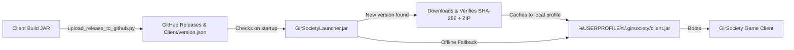

# Gir-Society RSPS — Rev 241 Server & Client

Welcome to **GirSociety**, a premier Old School RuneScape (OSRS) private game server emulator built on a high-performance **OSRS Revision 241** engine (`RuneLite 1.13.4`). GirSociety blends authentic, bleeding-edge OSRS content (Varlamore, Sailing #23, Desert Treasure 2, Project Rebalance) with an expansive suite of custom systems, crafting engines, pinnacle bosses, mystery crate codex, unique relics, pets, and quality-of-life enhancements.

---

## 🌟 Key Server Highlights & Features

### ⚔️ 1. Pinnacle Bosses & Custom Encounters (121 Bosses & Mobs)
Experience fully scripted, mechanically accurate pinnacle bosses along with custom world bosses:
* **Varlamore & Modern Encounters**: The Hueycoatl (Custodia Mountain arena, armor-break mechanics), Amoxliatl, Moons of Peril (Blood Moon, Blue Moon, Eclipse Moon), Scurrius, Araxxor, and Tormented Demons.
* **Desert Treasure 2 Bosses**: Vardorvis, Duke Sucellus, The Leviathan, and The Whisperer with complete phase shifts, projectile states, and sanity mechanics.
* **Raids & Pinnacle Bosses**: Tombs of Amascut (ToA), Chambers of Xeric (CoX), Theatre of Blood (ToB), Nex, Corporeal Beast, Alchemical Hydra, Phantom Muspah, Vorkath, Zulrah, and Cerberus.
* **Wilderness & World Bosses**: Artio, Calvar'ion, Spindel, Callisto, Vet'ion, Venenatis, Chaos Elemental, Scorpia, KBD, Revenants, and custom world bosses including *Baby Grashnak, Miniature Treants, Dune Golems, Crypt Scuttlers, Solar Dragons*, and the *Chibi Noxus Titan*.

---

### 🎁 2. Gir-Society Crates Codex (Tiered Mystery Crates)
An interactive unboxing minigame and reward economy integrated across the entire server (`::crates`):
* **5 Crate Tiers**: Bronze Supply, Silver Skilling, Gold Combat, Diamond Boss, and Mythic Celestial.
* **Virtual Key Management**: Players collect and store keys directly on their accounts without consuming inventory space.
* **Animated 60 FPS Carousel Unboxing**: Physics-based deceleration easing, authentic tick sound effects, colored rarity glows (*Common, Uncommon, Rare, Epic, Legendary, Mythic*), and winning item spotlight.
* **Jackpots & High-Tier Loot**: Scaled coin payouts (up to 5M GP jackpot) alongside 3rd Age relics, Torva/Masori pieces, Dragon Warhammers, and Mega-rare weapons.
* **Cross-System Acquisition**: Earn keys through daily task milestones, 99 skill prestige resets, pinnacle boss drops, and voting.

---

### ⚒️ 3. Gir-Society Item Codex & Custom Multi-Station Crafting
GirSociety features a curated, 100% functional crafting and upgrade codex with **75 cache-verified recipes** (`::items` / `::craft` / `::forge` / `::codex`):
* **7 Comprehensive Codex Tabs**: `All Items`, `⚒ Weapons`, `🛡 Armour`, `⛏ Skilling Tools`, `🧪 Alloys & Bars`, `💎 Infusions`, and `🍖 Food & Potions` with item icons, live backpack readiness checks, and interactive `[⚒ Forge / Craft]` & `[♻ Salvage]` buttons.
* **Combat Stats & Mechanics**: Live equipment combat stats grid (Stab/Slash/Crush/Magic/Ranged bonuses, Melee/Ranged strength, Magic dmg %, Prayer, Speed).
* **Item Infusion & Empowerment**: Combine rare boss drops with base gear to forge fortified and infused equipment (Godswords, Abyssal Tentacles, Avernic/Primordial/Pegasian/Eternal upgrades, Fortified Masori, Torva, Rancour, Bellator/Ultor/Venator/Magus).
* **Salvage & Dismantling**: Break down surplus forged or upgraded equipment with 75% material recovery.

---

### 🐾 4. Gir-Society Pets Codex & Follower System (90 Companions)
A comprehensive companion system supporting lore, summon animations, Probita auto-insurance, and persistent logout/relog follower tracking (`::pets` / `::pet` / `::petcodex`):
* **5 Companion Categories**: `Boss Pets`, `🌲 Skilling Pets`, `⚔ Custom Pets`, `📦 Crate / Minigames`, and `★ My Collection`.
* **Standard & Varlamore Pets**: Huey, Nid, Scurry, Amoxliatl Pet, Quetzal, Tiny Tempor, Abyssal Protector, Muphin, Wisp, Butch, Baron, Lil' Viathan, Lil' Creator, and all classic skilling, raid & boss pets.
* **Custom Boss Companion Pets**: Unique cache-verified follower pets across all 25 Gir-Society world bosses with automatic Probita insurance.
* **Live Unlock Tracker**: Persistent server-synced account tracker (`[PETS_SYNC]`) across backpack, bank, and active follower (`✔ X / 90`).

---

### 📜 5. Gir-Society Bosses Codex & Drop Directory (63 Bosses)
* **4 Tier Tabs + Source Filters**: Organized into `Leveling`, `Mid-Tier`, `High-Tier`, and `Mythic` progression categories across **25 ★ Gir-Society** and **38 OSRS Bosses** (`::bosses`).
* **Live Persistent Kill Count Tracker**: Server-persisted kill counter (`☠ Kill Count: X`) displayed directly on each boss's showcase view (`[GIR_KC_SYNC]`).
* **Full Drop Tables & Safe Lair Teleports**: Signature relics, unique boss pets, noted supply drops, tier-scaled Mystery Crate keys, and `⚡ Teleport to Lair` with Wilderness confirmation guards.
* **In-Game `::wiki <query>`**: Instant command linking player queries directly to verified combat stats, weaknesses, and drop tables.

---

### 🏛️ 6. Custom Grand Exchange & Arbitrage-Free Market
* **4,558-Item Sanitized Market Catalog**: Instant custom-only Grand Exchange Codex (`::ge` / GE Clerks / GE Booths) with 4-hour buy limits, 1% seller tax, and High-Alch/Shop arbitrage protection.
* **`⚡ SELL ALL TRADEABLES`**: Grouped inventory stack display and 2-click confirmation to liquidate tradeable loot tabs safely into coins (with Platinum Token & Bank overflow protection).
* **Banknote Resolution**: Automatic uncerting for selling and persistent `[✓] Deliver as Banknote` toggle for stack-friendly purchases.
* **★ Favorites System & Max Calculator**: Quick pins and 1-click Max buy calculation based on active coin stack and remaining 4h buy limit.

---

### 🏆 7. 24-Skill Prestige System, Active Perks & Prestige Shop
Master your skills to Level 99 and reset them through **10 prestige tiers** to unlock **24 real gameplay perks** (`::prestige` / `::pshop`):
* **Combat & Slayer Masteries**: Scaling accuracy, max hit, PvM damage soak, Prayer drain reduction (`-2%/rank`), out-of-combat HP regen, Ranged ammo save, Magic rune save, and bonus Slayer task points.
* **Skilling & Gathering Masteries**: Double log/ore/fish/herb/rune procs, Smithing bar save, Herblore secondary save, Cooking burn immunity, Agility run restore, and Thieving coin multipliers.
* **Integrated Prestige Shop**: Redeem Prestige Points directly in the UI for Supply Packs, 50k XP Lamps, Mystery Caskets,GP Pouches, and automatic Silver/Diamond/Mythic Crate Key milestones.

---

### 🎲 8. Provably-Fair Casino & Minigames
Server-verified wagering games with atomic balance checks and anti-scam guards (`::casino`):
* **Blackjack**: Full table rules with Hit, Stand, Double Down, and Split.
* **55x2 High-Roller Dice**: Classic d100 dice rolling with instant payouts.
* **Flower Poker**: 5-seed Mithril Seed evaluation ranking hands from High Card to 5 of a Kind.
* **Mines**: 5x5 minefield grid with scaling multipliers and instant cashout.

---

### 📅 9. Daily Tasks & Login Streaks
* **3-Tier Rotating Daily Tasks**: Refreshes daily at 00:00 UTC (Combat/Bossing, Skilling, Gathering, `::daily`).
* **Login Streaks**: Progressive login bonuses awarding XP lamps, skilling crates, mystery keys, and Daily Tokens.
* **Daily Rewards Shop**: Exchange earned tokens for cosmetic overrides, utility scrolls, and rare supply crates.

---

### 🗺️ 10. Teleport Hub, Currency HUD & Modern Combat
* **Teleport Nexus**: Categorized instant travel across cities, skilling hubs, boss chambers, and wilderness destinations (`::tp`).
* **Minimap Currency HUD**: Real-time draggable HUD tracking gathering currencies (Mining, Fishing, Woodcutting Coins).
* **100% Accurate Modern Combat**: Osmumten's Fang 2-roll accuracy, Tumeken's Shadow 3x/4x magic scaling, Scythe 3-hit arc, Soulreaper Axe stacks, Burning Claws, Voidwaker, Arceuus Thralls, Project Rebalance elemental vulnerabilities, and 30+ chargeable items.

---

### ⛏️ 11. Modern Skilling & Project Rebalance Mechanics
* **Continuous Skilling Loops**: Pickpocketing and Mining run on persistent continuous loops with automatic re-harvesting without spam clicking.
* **Project Rebalance Mining**: Slashed rock respawn timers matching modern OSRS (Runite 3m, Addy 1m, Mithril 45s, Coal 15s).
* **Modern Motherlode Mine**: Cooperative timed veins (23–27s lower floor, 36–40s upper floor), cleaning bonus XP on sack withdrawal, 100 Nugget upper level ladder unlock (Level 57 Mining), and 200 Nugget sack capacity upgrade.
* **Summer 2024 Run Energy Rebalance**: Energy recovery scales dynamically with Agility level from 20 to 80 units/tick (~1.25m full recharge at 99 Agility), with ~35% reduced unencumbered run drain.
* **Open Fish Barrel**: Automatically stores harvested fish up to 280 fish directly without interrupting active fishing cycles.
* **Modern Rooftop Agility**: Post-Project Rebalance lap completion bonus XP across all rooftop courses.

---

### 🛡️ 12. Staff Management Studio, Botting Studio & 3D World Editor
* **Admin Control Panel (`F6` Hotkey, Staff-Gated)**: Complete in-client management studio featuring real-time player directory, interactive moderation suite (kick/mute/ban with modal confirmation), 24-skill XP & level studio, and searchable Item Spawner catalog.
* **Gir-Society Botting Studio (`F7` Hotkey)**: GUI task orchestration, barrier-aware highway navigation, looting, and banking available to all players.
* **In-Game World & Spawn Studio (`F8` Hotkey, Staff-Gated)**: 3D scene editor allowing developers and admins to place/remove objects, spawn NPCs, visualize bounding boxes, and export map definitions directly to JSON.

---

## 🎮 How to Play

### 1. Download the Launcher
Download [`GirSocietyLauncher.jar`](https://github.com/yaitsbilly/gs-rsps-client/releases/latest/download/GirSocietyLauncher.jar) from the [**Releases Page**](https://github.com/yaitsbilly/gs-rsps-client/releases).

### 2. Launch & Auto-Update
* Double-click `GirSocietyLauncher.jar` (or run `java -jar GirSocietyLauncher.jar`).
* The launcher automatically checks GitHub for updates, downloads the newest client release asset, verifies SHA-256 + ZIP integrity, and launches into the game.
* **Offline Support**: If GitHub is unreachable, the launcher automatically starts the locally cached client from `%USERPROFILE%\.girsociety\client.jar`.

### 3. System Requirements
* **Java 11 or later** (Java 21 LTS Adoptium Eclipse Temurin recommended).
* Compatible with Windows, macOS, and Linux.

---

## 🔄 Client Auto-Update Pipeline

---

## 📦 Client Releases & Versioning
All official client builds are versioned following Semantic Versioning (`v3.8.x`) and published directly to GitHub Release Assets with SHA-256 checksums documented in [`version.json`](version.json).

---

## 💬 Community & Support
* **Official Discord**: Join our Discord server for updates, announcements, support, and community discussions: [**https://discord.gg/girsociety**](https://discord.gg/girsociety)
* **GitHub Issues**: Report client bugs or crashes via the [Issues tab](https://github.com/yaitsbilly/gs-rsps-client/issues).
* **Server Status**: Default server endpoint connects to port `43594` on Revision 241.

